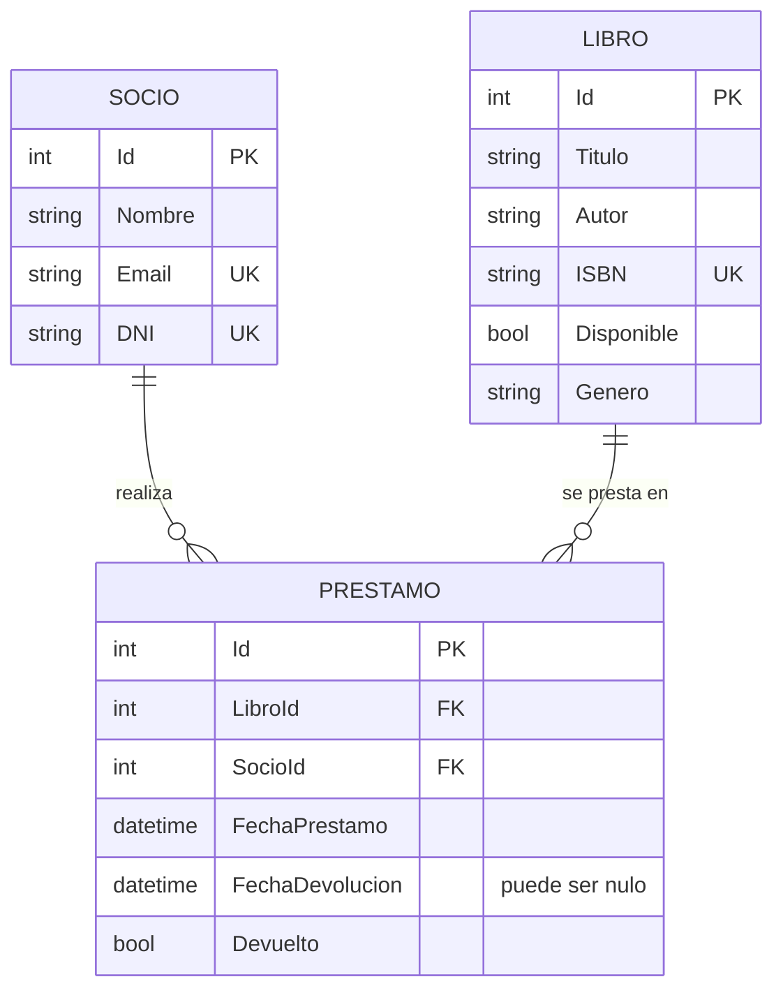
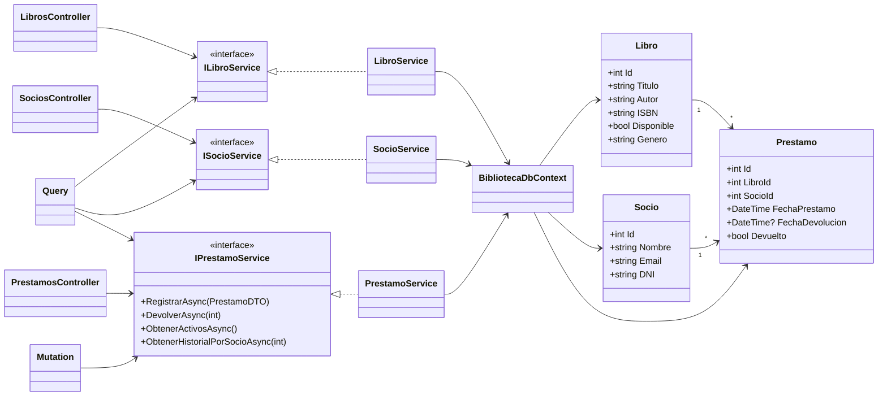

# api_biblioteca

API REST y GraphQL para gestionar una biblioteca: libros, socios y préstamos/devoluciones.
Proyecto final desarrollado en equipo con ASP.NET Core, Entity Framework Core (Code First) y GraphQL.

## Funcionalidades

- **Libros:** alta, baja, modificación y consulta.
- **Socios:** alta, baja, modificación y consulta, con validación de DNI y email.
- **Préstamos:** registrar préstamo, registrar devolución, listar préstamos activos e historial por socio.
- **Reglas de negocio:** no se presta un libro ya prestado, el libro y el socio deben existir, no se permiten devoluciones repetidas y el historial se conserva.
- **Dos accesos a los mismos servicios:** REST (con Swagger) y GraphQL.

## Requisitos

- [.NET 8 SDK](https://dotnet.microsoft.com/download/dotnet/8.0)
- SQL Server o SQL Server LocalDB (viene con Visual Studio)
- Herramienta de migraciones de EF Core:

```bash
dotnet tool install --global dotnet-ef --version 8.0.11
```

## Validaciones

- **ISBN:** 10 o 13 dígitos, sin guiones, y único por libro.
- **DNI:** 7 u 8 dígitos, sin puntos, y único por socio.
- **Email:** formato válido y único por socio (se guarda en minúsculas).
- Un libro o socio con préstamos registrados no se elimina, para conservar el historial.

## Instalación

```bash
git clone https://github.com/sofialei/api_biblioteca.git
cd api_biblioteca
dotnet restore
```

## Configuración

La cadena de conexión está en `Biblioteca_API/appsettings.json`. Por defecto usa SQL Server LocalDB; si usás otro servidor, cambiá el valor de `Server`:

```json
{
  "ConnectionStrings": {
    "DefaultConnection": "Server=(localdb)\\MSSQLLocalDB;Database=BibliotecaDb;Trusted_Connection=True;TrustServerCertificate=True"
  }
}
```


Crear la base de datos aplicando las migraciones:

```bash
dotnet ef database update --project Biblioteca_API
```

## Ejecución

```bash
dotnet run --project Biblioteca_API
```

Una vez iniciada la aplicación (la consola muestra el puerto):

| Recurso | Ruta |
|---|---|
| Swagger (REST) | `/swagger` |
| GraphQL | `/graphql` |

## API REST

| Método | Endpoint | Función |
|---|---|---|
| GET | `/api/libros` | Listar libros |
| GET | `/api/libros/{id}` | Buscar un libro |
| POST | `/api/libros` | Crear un libro |
| PUT | `/api/libros/{id}` | Modificar un libro |
| DELETE | `/api/libros/{id}` | Eliminar un libro |
| GET | `/api/socios` | Listar socios |
| GET | `/api/socios/{id}` | Buscar un socio |
| POST | `/api/socios` | Crear un socio |
| PUT | `/api/socios/{id}` | Modificar un socio |
| DELETE | `/api/socios/{id}` | Eliminar un socio |
| POST | `/api/prestamos` | Registrar un préstamo |
| PUT | `/api/prestamos/{id}/devolucion` | Registrar una devolución |
| GET | `/api/prestamos/activos` | Listar préstamos activos |
| GET | `/api/socios/{id}/prestamos` | Historial de préstamos de un socio |


## GraphQL

Se accede en `/graphql`. Allí se puede usar el IDE integrado (Banana Cake Pop) o cualquier cliente
que envíe un `POST` con `{ "query": "..." }`.
Usa los mismos servicios que REST, por lo que las reglas de negocio son idénticas.

### Consultas

Todos los libros:

```graphql
query {
  libros {
    id
    titulo
    autor
    isbn
    genero
    disponible
  }
}
```

Un libro por ID:

```graphql
query {
  libro(id: 1) {
    id
    titulo
    disponible
  }
}
```

Socios:

```graphql
query {
  socios {
    id
    nombre
    email
    dni
  }
}
```

Préstamos activos:

```graphql
query {
  prestamosActivos {
    id
    libroId
    tituloLibro
    socioId
    nombreSocio
    fechaPrestamo
    devuelto
  }
}
```

Historial de préstamos de un socio:

```graphql
query {
  historialSocio(socioId: 2) {
    id
    libroId
    tituloLibro
    fechaPrestamo
    fechaDevolucion
    devuelto
  }
}
```

### Mutaciones

Registrar un préstamo:

```graphql
mutation {
  registrarPrestamo(input: { libroId: 1, socioId: 2 }) {
    id
    libroId
    tituloLibro
    socioId
    nombreSocio
    devuelto
  }
}
```

Registrar una devolución:

```graphql
mutation {
  devolverPrestamo(id: 1) {
    id
    devuelto
    fechaDevolucion
  }
}
```

Si una regla de negocio no se cumple (por ejemplo, el libro ya está prestado), la respuesta incluye un campo `errors` con el mensaje.

## Pruebas

```bash
dotnet test
```

El proyecto `Biblioteca_API.Tests` incluye pruebas unitarias de cada módulo y pruebas de integración
(`IntegrationTests.cs`) que levantan la API en memoria con una base de datos en memoria y prueban REST y GraphQL.

## Estructura del proyecto

```
Biblioteca_API/
├── Controllers/    Endpoints REST
├── Models/         Entidades (Libro, Socio, Prestamo)
├── DTOs/           Objetos de transferencia
├── Interfaces/     Contratos de los servicios
├── Services/       Lógica de negocio
├── Data/           DbContext y configuración de EF Core
├── GraphQL/        Query y Mutation
├── Migrations/     Migraciones de EF Core
└── Program.cs      Configuración e inyección de dependencias
Biblioteca_API.Tests/   Pruebas unitarias y de integración
```

## Diagramas

### DER (modelo entidad-relación)

Un socio puede tener muchos préstamos y un libro puede aparecer en muchos préstamos (a lo largo del tiempo).
Las claves foráneas usan `Restrict`, por eso no se puede borrar un libro o socio con préstamos y el historial se conserva.



### UML (clases y dependencias)

Los controladores y los resolvers de GraphQL dependen de las interfaces; las interfaces las implementan los servicios,
y los servicios usan el `BibliotecaDbContext`.



## Diseño

- **Inyección de dependencias:** los servicios se registran en `Program.cs` y se reciben por constructor (REST) o con `[Service]` (GraphQL).
- **Inversión de dependencias:** controladores y resolvers dependen de interfaces (`ILibroService`, `ISocioService`, `IPrestamoService`), no de clases concretas.
- **Responsabilidad única:** cada servicio se ocupa de un solo módulo.
- **Sin duplicación:** REST y GraphQL comparten los mismos servicios.

## Equipo

| Módulo | Integrante |
|---|---|
| Libros | Tati |
| Socios | Mateo |
| Préstamos y devoluciones | Angie |
| Base de datos, arquitectura y REST | Sofia |
| GraphQL, pruebas de integración y documentación | Valeria |
